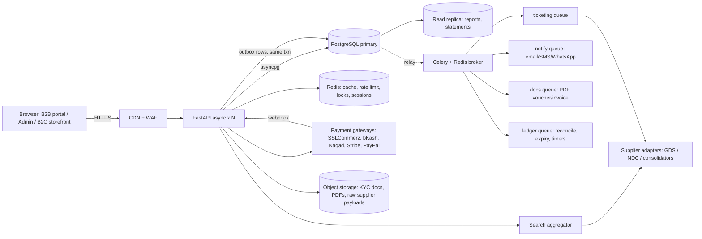

# OTA + Unified ERP: System Architecture Blueprint (Phase 1)

Status: **Phase 1 (v1.1), awaiting approval.** Code in `backend/` is real and tested; Phases 2-4 are not started.
Schema: 63 tables, validated against PostgreSQL 16 (19 tests; `docs/schema.generated.sql` is the compiled DDL).

## 1. Executive summary

- One FastAPI modular monolith, one PostgreSQL primary (+ read replica), Redis, Celery. Not microservices: the ledger and booking state must commit atomically, and a team of this size cannot operate 8 services.
- Multi-tenancy is a **tenant tree** (Parent > Sister Concern > B2B Agency > Sub-agent / Corporate; B2C storefronts hang off a concern). Every business table carries `organization_id`; Postgres Row-Level Security enforces it a second time.
- Money lives in a **double-entry journal** (append-only, balanced by a DB trigger) with wallets as a cached view, `DECIMAL(12,2)`, and DB `CHECK`s that make overdraft and one-sided ledger lines impossible.
- Double-booking and double-charging are stopped by **three layers**; the Redis lock is only the fast path. The database unique indexes are the authority.
- The 1M B2C figure is **not the hard part**. Supplier search fan-out, look-to-book ratios, fare freshness and payment reconciliation are. The design spends its effort there.

## 2. Assumptions I am challenging

| Assumption in the brief | Reality | Decision |
|---|---|---|
| "Jinja2 + HTMX wired 100% faithfully to my UI" | The prototype is a 270 KB single-file vanilla-JS app. It computes fares, ledger and booking state **in the browser**. That logic must move server-side; HTMX re-rendering 40+ views would be a rewrite, and "100% pixel-faithful" cannot be promised through a rewrite. | **API-first.** CSS and JS extracted verbatim to `/static`; the in-browser data layer is replaced by API calls; Jinja renders the shell/auth only; HTMX only for admin list/detail fragments. Needs your approval (section 12). |
| "1M B2C users" = scaling problem | 1M user rows is small for Postgres. B2C bookings are bursty and search-heavy; cost and risk sit in supplier calls. | Design for ~100x searches per booking with a cache, single-flight, per-supplier rate limits. |
| Redis lock prevents double booking | Redis locks expire, fail over and can be lost. | Lock = optimisation. Authority = idempotency key + DB unique indexes + wallet row lock. |
| One platform for B2B and B2C | Different risk: B2C needs card payments, refunds, support, fraud; B2B needs credit, wallets, statements. | One codebase, separate storefront tenants, separate rate-limit buckets and Celery queues. |
| Prototype UI covers B2C | **It does not.** The UI built so far is the B2B agent portal and admin console. | B2C storefront UI/UX must be designed before Phase 4 can cover B2C. |
| Fares can be cached freely | GDS/NDC contracts restrict caching and charge on look-to-book above thresholds. | Short TTL (default 120 s, per-tenant), mandatory re-price before booking, and look-to-book telemetry (`search_request_logs`). Confirm terms with each supplier. |

## 3. Architecture



Request path rules:
1. Auth: JWT (15 min) + rotating refresh; `token_version` on the user revokes all tokens. MFA per profile choice (email / authenticator / off); the TOTP QR is shown once at enrolment, never at sign-in.
2. Tenant middleware resolves the caller's visible org set from `organizations.path` and sets `SET LOCAL app.org_paths` for RLS.
3. Every mutating endpoint requires `Idempotency-Key`. Stored in `idempotency_keys`; same key + different body returns 422.
4. Anything slow or external (ticketing, PDF, SMS) is an outbox row written in the same transaction as the state change.

## 4. Multi-tenancy and RBAC

- `organizations.path` is a materialized path (`/root/concern/agency/`). "Everything under X" = `path LIKE '/…/X/%'` using a `text_pattern_ops` index. No recursive CTEs on hot paths.
- `organization_id` on a row = the **owning tenant**. Users see rows whose owning org is in their visible set. Sister concerns are isolated from each other; the Parent sees all; an agency sees itself and its sub-agents.
- RLS (Phase 2): policy `organization_id IN (visible set)` on every tenant table; the app DB role is not a superuser and cannot bypass RLS. A forgotten `WHERE` in application code then returns nothing instead of leaking another tenant.
- Global (non-tenant) tables, explicit list in `GLOBAL_TABLES`: `organizations`, `roles`, `permissions`, `role_permissions`, `airlines`, `airports`, `suppliers`. A test fails if any other table lacks `organization_id`.
- Roles: Super Admin, Sister Concern Admin, Accountant, B2B Agent, B2C Customer, **plus Agency Owner** (your prototype separates owner from staff agent; I added it, tell me if you want it removed). Grants are `(user, org, role)` and apply to that org and its descendants. Permissions are strings (`booking.issue`, `ledger.read`, `agent.suspend`, …) mapped to roles; checks are permission-based, never role-name-based.
- Supplier identity (`suppliers.code/name`) is internal only. Agents see the admin-set indicator from `supplier_indicators`. Response serializers for non-staff roles must not include supplier fields; a contract test will enforce it in Phase 3.

## 5. Money, ledger, wallets

- All amounts `DECIMAL(12,2)`; rates `DECIMAL(9,6)`. A bare `Decimal` annotation maps to `(12,2)`, so float is impossible by default; tests fail on any `FLOAT` except airport coordinates. Max single amount 9,999,999,999.99 per column.
- One chart of accounts per legal entity. Wallet balances are LIABILITY accounts (we owe the agent). Inter-company flows use `counterparty_org_id` on ledger lines.
- `journal_entries` (header, `txn_ref` = Transaction ID, idempotency key, reversal link) + `ledger_entries` (one debit **or** credit per line, `BIGINT` identity for total order). Lines are append-only; corrections are reversing journals. A deferred constraint trigger (Alembic migration, Phase 2) rejects any journal where `SUM(debit) != SUM(credit)`.
- `wallets.balance` is a cache. `CHECK (balance + credit_limit - held_amount >= 0)` blocks overdraft in the DB. A nightly job recomputes from the ledger and alerts on any drift.
- Debit path (single transaction): `SELECT … FOR UPDATE` wallet → check available → insert journal + lines → update wallet. Issue uses hold → capture/release so funds are reserved while the supplier call is in flight.
- Prototype rules mapped: fare = Base − Commission + Tax + AIT + Markup as `booking_price_lines`; **AIT is never refundable** (`refundable=false`, copied into every void/refund quote); reissue charge = fare diff + tax diff + airline charge + service charge as `after_sales_quote_lines`; the agent cannot approve a quote unless wallet covers it exactly (wallet CHECK is the backstop); quotation expiry runs on the real clock (`quote_expires_at`, partial index for the expiry sweeper).
- Tax and AIT rates are data in `tax_rules` with effective dates. **Verify against current NBR rules before go-live**; nothing here is tax advice.

## 6. Booking engine

State machine (`bookings.status`): `payment_pending → hold (PNR exists, not ticketed) → partial_payment → issue_in_process → issued`; **uncertain-outcome states `booking_unknown` and `ticketing_unknown`**, plus `manual_review`; side exits `issue_rejected`, `cancelled`, `expired`; after-sales end states `voided`, `refunded`, `reissued`. A PNR is not a ticket and an authorization is not a capture, so booking, ticketing and payment are tracked separately. Void/refund/reissue progress (quotation sent/expired/approved…) lives on `after_sales_requests.status`. The complete status list still needs confirming with ops. Every transition writes `booking_status_history` and goes through one `transition()` function; nothing updates `status` directly.

Issuing is a **saga**, never one long transaction:
1. Txn A: validate, re-price live, create booking, hold wallet funds, write outbox `ticketing.issue` (dedupe key = booking id).
2. Celery `ticketing` queue: call the supplier (idempotent adapter).
3. Txn B on success: capture hold → journal + ledger, tickets rows, status `issued`. On clear failure: release hold, `issue_rejected`.
4. **Timeout / unknown outcome:** the attempt is recorded as `UNKNOWN` in `supplier_attempts` and the booking moves to `booking_unknown` / `ticketing_unknown`; a reconciler queries the supplier by PNR/order reference before any retry. Every adapter call returns `SUCCESS | BUSINESS_REJECTED | RETRYABLE_FAILURE | UNKNOWN`. Blind retry of ticketing risks double ticketing, which is the costliest failure in this system.

Double-booking defence, in order: Redis lock `lock:book:{org}:{dedupe}` (NX, 30 s, fencing token) → idempotency key → DB: `uq_bookings_supplier_pnr`, `uq_bookings_active_dedupe` (same passengers + same flights cannot have two active bookings), `uq_bookings_organization_id_idempotency_key`. All verified by `tests/test_db_constraints.py` on real PostgreSQL.

Mixed-airline round trips: two bookings sharing `mix_group_id` (`direction` out/ret), each with its own PNR; rules from `airline_mix_rules` (canonical pair, allow/block) + `ota_settings` + `airlines.one_way_fare_combinable`. Wallet debit is one journal across both.

Search aggregator: `SupplierAdapter` interface (`search`, `price`, `book`, `issue`, `cancel`, `retrieve`); adapters run concurrently with per-supplier timeout, circuit breaker and rate limit; partial results are returned when one supplier is slow. Cache key = hash(normalized request, pricing group); single-flight so 1,000 identical searches hit suppliers once.

### 6a. Changes in v1.1 (after reviewing your GDS-first document, knowledge vault and API/NDC manuals)
Added 9 tables and 4 booking states because the documents exposed real gaps in v1.0:
- `price_quotes`: every reprice kept immutably, with the customer's acceptance and a hash of the fare conditions shown. This is the evidence for chargebacks and ADM disputes.
- `supplier_attempts`: one row per external mutating call (correlation id, supplier transaction id, status, resolution). `UNKNOWN` rows are the reconciliation queue. Unique per booking + operation + idempotency key.
- `supplier_capabilities` + `supplier_accounts.ticketing_model`: per-supplier, per-airline capability matrix (supported / via consolidator / manual / unsupported). Shopping support never implies servicing support.
- `reconciliation_runs` / `reconciliation_items`: daily four-way match with the 11 exception queues from the manuals (booking unknown, ticket not issued, captured with no booking, duplicate capture, refund overdue, supplier amount mismatch, ADM/ACM review …), each with owner, amount at risk and sign-off.
- `payment_refunds` and `payment_disputes`: PSP refunds and chargebacks (cancellation confirmed is not refund completed).
- `adm_acm_cases`: memo cases; a CHECK forbids a deadline without a cited source (no generic deadlines).
- `fx_rates`: rate used for each supplier-currency conversion.

## 7. Background work (Celery)

| Queue | Jobs | Notes |
|---|---|---|
| `ticketing` | issue, void, refund, reissue calls | low concurrency, strict per-supplier rate limit, never auto-retry on unknown outcome |
| `notify` | email, SMS (BTRC-compliant sender), WhatsApp | retry with backoff, provider message id stored |
| `docs` | voucher, e-ticket, invoice PDFs | output to object storage |
| `ledger` | wallet reconciliation, hold expiry, quote expiry, T/L and partial-payment due sweeps, partition creation | Celery beat; all idempotent |
| `default` | outbox relay, report builds | |

Outbox relay uses `FOR UPDATE SKIP LOCKED`, so multiple relays are safe.

## 8. Scale and indexing

Planning figures are estimates to be replaced by your real volumes: at 3M bookings/year × ~5 ledger lines ≈ 15M ledger rows/year; bookings ≈ 3M rows/year. A single Postgres primary handles this; the work is indexing and hygiene, not sharding.

- Hot lookups: `bookings(organization_id, status, created_at)`, `bookings(organization_id, created_at)`, partial index on open T/L, PNR indexes, `ledger_entries(account_id, id)` and `(wallet_id, id)` for statements, `users(organization_id, email_norm)` unique, `organizations(path text_pattern_ops)`.
- Partial unique indexes carry the safety rules (supplier PNR, active dedupe, idempotency keys).
- **Partitioning:** only append-only logs with no inbound foreign keys (`audit_logs`, `supplier_api_logs`, `search_request_logs`), monthly RANGE on `created_at`; retention by dropping partitions. Ledger and bookings are *not* partitioned now (inbound FKs, and not needed at this volume); revisit past ~100M ledger rows.
- Connection budget: PgBouncer (transaction mode) in front of Postgres; async pool per API worker. Read replica for reports and statements.
- Raw supplier XML/JSON goes to object storage, not Postgres.
- Desk search (Agent ID, name, username, phone, PNR, booking id): exact-match indexes exist; add `pg_trgm` GIN on `organizations.name` in the first migration.

## 9. ERD (core relationships)

```mermaid
erDiagram
  ORGANIZATIONS ||--o{ ORGANIZATIONS : parent
  ORGANIZATIONS ||--o{ USERS : home
  USERS ||--o{ USER_ORG_ROLES : granted
  ROLES ||--o{ USER_ORG_ROLES : defines
  ROLES ||--o{ ROLE_PERMISSIONS : has
  USERS ||--o| B2C_PROFILES : has
  USERS ||--o{ TRAVELLERS : saves
  ORGANIZATIONS ||--o{ ACCOUNTS : chart
  ORGANIZATIONS ||--o{ WALLETS : owns
  WALLETS ||--o{ WALLET_HOLDS : reserves
  WALLETS ||--o{ DEPOSIT_REQUESTS : funded_by
  JOURNAL_ENTRIES ||--|{ LEDGER_ENTRIES : lines
  ACCOUNTS ||--o{ LEDGER_ENTRIES : posted_to
  ORGANIZATIONS ||--o{ BOOKINGS : sells
  BOOKINGS ||--o{ BOOKING_PASSENGERS : carries
  BOOKINGS ||--o{ FLIGHT_SEGMENTS : flies
  BOOKINGS ||--o{ TICKETS : issues
  BOOKINGS ||--o{ BOOKING_PRICE_LINES : priced_by
  BOOKINGS ||--o{ BOOKING_STATUS_HISTORY : audited
  BOOKINGS ||--o| PARTIAL_PAYMENT_PLANS : may_have
  BOOKINGS ||--o{ AFTER_SALES_REQUESTS : changed_by
  AFTER_SALES_REQUESTS ||--o{ AFTER_SALES_QUOTE_LINES : quotes
  BOOKINGS ||--o{ BOOKINGS : reissue_child
  BOOKINGS }o--|| SUPPLIER_ACCOUNTS : via
  SUPPLIERS ||--o{ SUPPLIER_ACCOUNTS : has
  SUPPLIERS ||--o{ SUPPLIER_INDICATORS : shown_as
  AIRLINES ||--o{ COMMISSION_RULES : priced
  JOURNAL_ENTRIES }o--o| BOOKINGS : for
  PAYMENTS }o--o| BOOKINGS : pays
  INVOICES ||--|{ INVOICE_LINES : lines
  VISA_APPLICATIONS ||--o{ VISA_STAGE_PAYMENTS : stages
  GROUP_FARES ||--o{ BOOKINGS : sold_as
```



Full table list by module: **v1.1 additions:** price_quotes, supplier_attempts, supplier_capabilities, adm_acm_cases (ota); reconciliation_runs, reconciliation_items, payment_refunds, payment_disputes, fx_rates (erp).

Full table list by module (v1.0 base): **users** (organizations, org_profiles, org_kyc_documents, roles, permissions, role_permissions, users, user_org_roles, mfa_backup_codes, b2c_profiles, travellers, loyalty_accounts, loyalty_ledger, agent_ops) · **erp** (accounts, journal_entries, ledger_entries, wallets, wallet_holds, deposit_requests, payments, payment_events, commission_rules, markup_rules, service_charge_rules, tax_rules, invoices, invoice_lines) · **ota** (suppliers, supplier_accounts, supplier_indicators, airlines, airports, ota_settings, airline_mix_rules, bookings, booking_passengers, flight_segments, tickets, booking_price_lines, booking_status_history, partial_payment_plans, after_sales_requests, after_sales_quote_lines, group_fares, visa_applications, visa_stage_payments, visa_events) · **core** (idempotency_keys, outbox_events, notifications, audit_logs, supplier_api_logs, search_request_logs).

## 10. Prototype requirement → schema traceability

| Requirement you gave | Where it lives |
|---|---|
| Commission rules per airline / route type (SITI, SOTI, SOTO, Domestic) / class / date | `commission_rules` |
| Fare = Base − commission + tax + AIT + markup; AIT = (Gross − (UT+BD+other)) × 0.003 | `booking_price_lines`, `tax_rules` (rate as data) |
| Global / agency / airline / route markup; service charges | `markup_rules`, `service_charge_rules` |
| Wallet, credit limit, manual deposit approval, bKash/Nagad/Rocket/bank | `wallets`, `deposit_requests` (unique per method + reference) |
| Partial payment with admin amount and due date; auto-cancel or flag | `partial_payment_plans` + `ledger` sweeper |
| General ledger fields (Txn ID, Booking ref, Agent ID, Dr/Cr, Balance After, method, status, time) | `journal_entries`, `ledger_entries` |
| Work-permit visa: staged payments, pipeline, tracking log | `visa_applications`, `visa_stage_payments`, `visa_events` |
| Group fares with quota, deposit and ticketing deadlines | `group_fares` (seat quota CHECK) |
| Booking ID unique across all statuses; hold T/L | `bookings.booking_ref`, `ticket_time_limit_at` |
| Void / refund / reissue with quotation, expiry, rejection serial, linked new booking | `after_sales_requests`, `after_sales_quote_lines`, `bookings.parent_booking_id` |
| Hide GDS/API names, admin indicator | `suppliers` (internal) vs `supplier_indicators` |
| Branded fares, Best Buy, mixed-airline round trips with admin override | `ota_settings`, `airline_mix_rules`, `bookings.mix_group_id` |
| Admin "Others" desk (warn, suspend, watchlist, note, reset 2FA) with unique operation id | `agent_ops`, `organizations.on_watchlist/status` |
| Top selling airlines / clients | read-model queries on `bookings` (replica); materialized views if slow |
| 2FA: email or authenticator, QR once, backup codes | `users.mfa_method`, `totp_secret_enc`, `mfa_backup_codes` |
| Profile: logo, address, phones editable; legal name admin-only | `org_profiles` (columns), `organizations.legal_name` (service-level rule) |

## 11. Directory structure

```
backend/
├── pyproject.toml
├── alembic/                    (Phase 2)  versions/ + extensions, RLS, balance trigger, partitions
├── tools/                      (Phase 2)  seed roles/permissions/CoA
├── tests/
│   ├── test_schema_invariants.py          DONE  structural rules, run in CI
│   └── test_db_constraints.py             DONE  real PostgreSQL constraint tests
└── app/
    ├── main.py                 (Phase 2)
    ├── models.py               DONE  imports all models for Alembic
    ├── db/        base.py enums.py        DONE   session.py (Phase 2)
    ├── core/      models.py DONE          config.py security.py jwt.py tenant.py rbac.py redis_lock.py idempotency.py outbox.py (Phase 2)
    ├── modules/
    │   ├── users/ models.py DONE          schemas.py service.py router.py (Phase 2)
    │   ├── erp/   models.py DONE          ledger.py wallet.py pricing.py invoicing.py router.py (Phase 3)
    │   └── ota/   models.py DONE          adapters/ aggregator.py booking.py state_machine.py aftersales.py router.py (Phase 3)
    ├── workers/                (Phase 3)  celery_app.py, tasks/{ticketing,notify,docs,ledger}.py
    ├── templates/              (Phase 4)  Jinja shell + HTMX fragments, from your UI
    └── static/                 (Phase 4)  your CSS/JS, extracted unmodified
```

## 12. Frontend integration: decision needed

| Option | What it means | Fidelity to your UI | Risk |
|---|---|---|---|
| **A. API-first (recommended)** | Keep your CSS and JS as-is in `/static`; replace the in-browser data/engine layer with API calls; Jinja serves shell and login; HTMX for admin tables/forms | Highest: markup untouched | Medium: every function that mutates state becomes an endpoint |
| B. Full server-rendered HTMX | Rewrite each of 40+ views as Jinja templates | Cannot be guaranteed; each view re-implemented | High: long, regression-prone |
| C. Hybrid | A for search/booking/wallet; B for admin tables | High | Medium |

Whatever is chosen, **fare, ledger, wallet and booking logic must not remain in the browser.**

## 13. Security and compliance

- Passwords: argon2id. TOTP secrets and passport numbers encrypted at rest (AES-GCM envelope, key id stored for rotation); equality lookups via HMAC hash only.
- PCI DSS: card entry only on gateway-hosted pages; we store gateway ids, never PANs (SAQ-A scope). Webhooks verified by signature and deduplicated by `(provider, event_id)`.
- Rate limiting per IP, per user, per tenant (Redis sliding window); stricter on login, OTP and search.
- Audit log for every privileged action, including agent-desk operations and ledger reversals.
- Personal data: keep personal information and privacy rules intact (your stated rule); no PII in logs; retention policy per table. Bangladesh data-protection and payment-service regulation (Bangladesh Bank, BTRC for SMS) must be confirmed with counsel; I have not verified current requirements.
- Secrets in a secret manager; `supplier_accounts.credentials_ref` stores a reference only.

## 14. Build plan and exit criteria

| Phase | Scope | Done when |
|---|---|---|
| 1 (this) | Blueprint, schema, models, structure | You approve; invariant + DB tests green |
| 2 | FastAPI app, config, JWT + MFA, tenant middleware + RLS, RBAC, Redis cache/lock/rate-limit, idempotency, outbox relay, Alembic baseline (extensions, balance trigger, partitions, trgm) | Cross-tenant read attempts fail in tests; load test of auth + idempotency; migrations apply cleanly on empty DB |
| 3 | Supplier adapter interface + sandbox adapter, search aggregator, pricing engine, booking saga + state machine, ledger/wallet service, deposits, after-sales, Celery workers | End-to-end booking against a sandbox supplier; ledger always balances under concurrent load; no double ticket in chaos tests |
| 4 | Wire the UI per section 12; skeletons, error states | Click-through parity with the prototype on the agreed option |

## 15. Risks, alternatives, worst case

- **Supplier access** is the real gating item: live GDS/NDC credentials, certification and PNR-creation rights take weeks to months and have contract terms (caching, look-to-book, ADM exposure). Until then Phase 3 runs against a sandbox/mock adapter. Engineering cannot shorten this.
- **ADM/ACM and BSP**: memo cases are modelled (`adm_acm_cases`); BSP billing/settlement statement import and matching are not yet (Phase 5 candidate).
- **Currency precision**: `DECIMAL(12,2)` suits BDT/USD but not 3-decimal currencies (KWD, BHD, OMR) or 0-decimal ones (JPY). Until you decide how these settle, such supplier amounts are converted to BDT/USD at `fx_rates`.
- **Wallet/ledger correctness** is the highest-impact code. Mitigation: DB constraints, property-based concurrency tests, nightly reconciliation, reversing-journal-only corrections.
- **Scope**: B2C storefront UI, hotel supplier, insurance and package products are modelled only at the booking-core level; their detail tables are Phase 5+.
- Alternatives considered: microservices (rejected: transactional coupling, operating cost); schema-per-tenant (rejected: thousands of B2C/agency tenants, migration pain); database-per-sister-concern (kept possible later because `organization_id` exists on every table).
- **Worst case**: a supplier timeout during issue followed by an automatic retry produces two tickets, or a ledger bug debits an agent twice. Both are addressed above (reconcile-before-retry; idempotency + constraints), and both will have dedicated chaos/concurrency tests in Phase 3.

## 16. Decisions needed from you to start Phase 2

0. **Stack conflict.** Your brief requires Python/FastAPI. The GDS-first document and the vault's note from 12 June propose or require Node.js/NestJS. I am continuing with Python/FastAPI because your latest instruction is explicit. Confirm, because it cannot be mixed.
0a. **Ticketing authority.** Who issues tickets: your own IATA accreditation, a consolidator, or a host agency? This decides which GDS/API products are even usable and is the gating item for Phase 3.

1. Frontend option A, B or C (section 12). My recommendation: A (with HTMX for admin tables).
2. Keep the added **Agency Owner** role?
3. Is a separate B2C storefront UI planned, and who designs it?
4. Which supplier(s) will you have sandbox credentials for first (names stay internal)?
5. Hosting target for staging/production (AWS / Azure / GCP / Bangladesh data centre) and whether data residency is required.
6. Which payment gateways go live first (SSLCommerz, bKash, Nagad, Stripe)?
7. Confirm the full booking and after-sales status lists with operations.

## 17. Limitations

- Schema and rules are derived from the prototype and your messages; they are not yet validated against live supplier responses or real volumes.
- Row counts and capacity statements are estimates, not benchmarks. No load testing has been done.
- Not implemented yet: RLS policies, balance trigger, partitions and extensions (Alembic, Phase 2); auth, API, workers, adapters.
- Nothing here is legal, tax or regulatory advice; NBR, Bangladesh Bank and data-protection requirements need verification.
